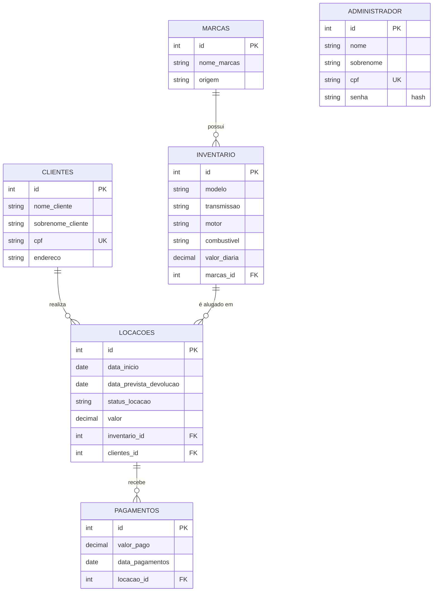

# Rental System

API REST para gerenciamento de uma locadora de veículos, desenvolvida em **Python com Flask**. O sistema controla marcas, veículos, clientes, locações e pagamentos, com autenticação de administradores e documentação interativa via Swagger.

## Funcionalidades

- CRUD de **marcas**, **veículos** (inventário), **clientes** e **pagamentos**
- **Locações** com cálculo automático do valor (dias x diária do veículo) e controle de status
- Bloqueio de locação para veículo que já está alugado (`ATIVA` ou `ATRASADA`)
- **Pagamentos vinculados à locação**, com controle de saldo (a soma não pode ultrapassar o valor)
- Autenticação de administradores com **Flask-Login** (sessão por cookie) e senhas com **hash**
- Documentação **Swagger** (OpenAPI 3) disponível em `/apidocs/`

## Tecnologias

| Tecnologia | Uso |
|---|---|
| Python / Flask 2.3 | API e rotas (blueprints) |
| Flask-SQLAlchemy / SQLAlchemy 2 | ORM e modelos |
| MySQL + PyMySQL | Banco de dados |
| Flask-Login | Autenticação por sessão |
| Werkzeug | Hash de senhas |
| Flasgger | Documentação Swagger a partir do `swagger.yaml` |
| python-dotenv | Variáveis de ambiente |

## Estrutura do projeto

```
Rental_System/
├── app/
│   ├── __init__.py            # create_app: configuração, Swagger e blueprints
│   ├── extensions.py          # db (SQLAlchemy) e login_manager
│   ├── models.py              # modelos do banco
│   ├── auth/
│   │   ├── __init__.py        # blueprint /auth
│   │   └── routes.py          # login, logout e registro
│   ├── service/
│   │   ├── locacoes_service.py    # regras de negócio das locações
│   │   └── pagamentos_service.py  # regras de negócio dos pagamentos
│   └── src/
│       ├── __init__.py        # blueprints dos recursos
│       └── routes.py          # rotas de marcas, veículos, clientes, pagamentos e locações
├── swagger.yaml               # documentação da API
├── requirements.txt
└── run.py                     # ponto de entrada
```

As regras de negócio de locações e pagamentos ficam na camada `service`, separadas das rotas.

## Modelo de dados



## Regras de negócio

### Locações

- O cliente e o veículo precisam existir, e o veículo precisa ter `valor_diaria` maior que zero.
- Um veículo com locação `ATIVA` ou `ATRASADA` não pode ser alugado novamente.
- As datas usam o formato `YYYY-MM-DD`, e a devolução prevista deve ser posterior ao início.
- O **valor é calculado pelo servidor**: número de dias x `valor_diaria` do veículo. Não é enviado na requisição.
- Toda locação nasce com status `ATIVA`.

Transições de status permitidas (`PATCH /api/locacao/{id}`):

| De | Para |
|---|---|
| `ATIVA` | `FINALIZADA`, `ATRASADA`, `CANCELADA` |
| `ATRASADA` | `FINALIZADA` |
| `FINALIZADA` / `CANCELADA` | (estados finais) |

### Pagamentos

- Todo pagamento pertence a uma locação (`locacao_id`), que deve existir e não pode estar `CANCELADA`.
- O valor deve ser maior que zero e a data deve estar em `YYYY-MM-DD`.
- A soma dos pagamentos não pode ultrapassar o valor da locação.
- As consultas de locação devolvem `valor_pago` (soma dos pagamentos) e `saldo` (valor - valor pago).

> Valores monetários (`Decimal`) e datas são serializados pelo Flask como texto, por exemplo `"500.00"` e `"Thu, 08 Oct 2026 00:00:00 GMT"`.

## Como executar

### Pré-requisitos

- Python 3.10 ou superior
- MySQL em execução

### Passo a passo

```bash
# 1. Clone o repositório
git clone https://github.com/<seu-usuario>/Rental_System.git
cd Rental_System

# 2. Crie e ative o ambiente virtual
python -m venv venv
venv\Scripts\activate            # Windows
# source venv/bin/activate       # Linux/Mac

# 3. Instale as dependências
pip install -r requirements.txt
```

4. Crie o banco de dados no MySQL (o nome é o que você colocar em `DB_NAME`):

```sql
CREATE DATABASE rental_system;
```

5. Crie o arquivo `.env` na raiz do projeto (veja a próxima seção).

6. Inicie a aplicação:

```bash
python run.py
```

As tabelas são criadas automaticamente na primeira execução (`db.create_all()`). A API sobe em `http://127.0.0.1:5000` e o Swagger fica em `http://127.0.0.1:5000/apidocs/`.

> O `create_all` só cria tabelas que ainda não existem; ele não altera tabelas já criadas. Se mudar um modelo depois, ajuste a tabela manualmente ou use migrations.

### Variáveis de ambiente

Crie um arquivo `.env` na raiz do projeto com as variáveis abaixo. Ele já está no `.gitignore` e **não deve ser enviado ao GitHub**.

| Variável | Descrição |
|---|---|
| `DB_USER` / `DB_PASSWORD` | Usuário e senha do MySQL |
| `DB_HOST` / `DB_PORT` | Endereço e porta do MySQL |
| `DB_NAME` | Nome do banco criado no passo 4 |
| `SECRET_KEY` | Chave que assina a sessão. Se ausente, o código usa um valor de desenvolvimento, que **não deve ser usado em produção** |

## Autenticação

Todas as rotas, exceto `POST /auth/login`, exigem um administrador autenticado. O login cria um cookie de sessão, que clientes como o Postman guardam automaticamente.

### Primeiro administrador

O `POST /auth/registro` exige um administrador já logado, então o primeiro precisa ser criado direto no banco de dados, com a senha em hash (gerada com `generate_password_hash`, do Werkzeug). A partir daí, o login é feito por `POST /auth/login` com `nome` e `senha`.

## Endpoints

Todos exigem login, exceto `POST /auth/login`. A documentação completa (corpos, respostas e exemplos) está no Swagger.

### Autenticação

| Método | Rota | Descrição |
|---|---|---|
| POST | `/auth/login` | Login do administrador |
| POST | `/auth/logout` | Encerra a sessão |
| POST | `/auth/registro` | Cadastra um novo administrador |

### Marcas

| Método | Rota | Descrição |
|---|---|---|
| POST | `/api/marca/add` | Cadastrar marca |
| GET | `/api/marca/` | Listar marcas |
| GET | `/api/marca/{id}` | Buscar marca por ID |
| PUT | `/api/marca/upadate/{id}` | Atualizar marca |
| DELETE | `/api/marca/delete/{id}` | Excluir marca |

### Inventário (veículos)

| Método | Rota | Descrição |
|---|---|---|
| POST | `/api/inventario/add` | Cadastrar veículo |
| GET | `/api/inventario/` | Listar veículos |
| GET | `/api/inventario/{id}` | Buscar veículo por ID |
| PUT | `/api/inventario/{id}` | Atualizar veículo |
| DELETE | `/api/inventario/delete/{id}` | Excluir veículo |

### Clientes

| Método | Rota | Descrição |
|---|---|---|
| POST | `/api/cliente/add` | Cadastrar cliente |
| GET | `/api/cliente/` | Listar clientes |
| GET | `/api/cliente/{id}` | Buscar cliente por ID |
| PUT | `/api/cliente/update/{id}` | Atualizar cliente |
| DELETE | `/api/cliente/delete/{id}` | Excluir cliente |

### Pagamentos

| Método | Rota | Descrição |
|---|---|---|
| POST | `/api/pagamentos/add` | Registrar pagamento de uma locação |
| GET | `/api/pagamentos/` | Listar pagamentos |
| GET | `/api/pagamentos/{id}` | Buscar pagamento por ID |
| PUT | `/api/pagamentos/{id}` | Atualizar pagamento |
| DELETE | `/api/pagamentos/delete/{id}` | Excluir pagamento |

### Locações

| Método | Rota | Descrição |
|---|---|---|
| POST | `/api/locacoes/add` | Criar locação |
| GET | `/api/locacoes` | Listar locações (com `valor_pago` e `saldo`) |
| GET | `/api/locacao/{id}` | Buscar locação por ID |
| PATCH | `/api/locacao/{id}` | Atualizar o status da locação |


